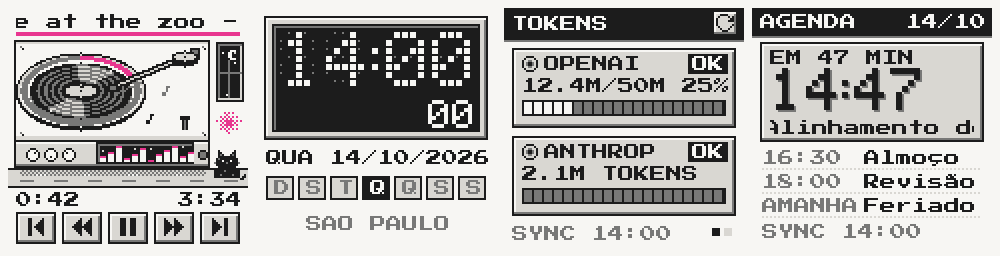

# geek-panel

Painel em pixel art para o meu GeekMagic SmallTV: um toca-discos que mostra o que está tocando, relógio, consumo de tokens e a agenda do dia.



É um app de desktop (Electron + React + TypeScript). Cada tela é desenhada em 120x120 pixels, metade dos 240x240 do display, então no aparelho cada pixel vira 2x2 sem borrar.

## Telas

- **Player**: mostra e controla o que está tocando. Lê os players abertos no Linux (MPRIS), o Spotify e links do YouTube / YouTube Music. Tem play/pause, faixa anterior e próxima, voltar e avançar 10 s, volume, e dá para clicar no anel de progresso para pular. Ao trocar de faixa o vinil sai e entra outro.
- **Relógio**: digital (matriz de LED), analógico e flip.
- **Tokens**: consumo do mês da OpenAI e da Anthropic, com um limite que eu defino. As duas só entregam isso para chave de administração; a chave comum não lê consumo.
- **Agenda**: próximos eventos do Google Agenda, com aviso 10 e 5 minutos antes (dá para mudar) e na hora de começar.

## Rodando

```
yarn
yarn dev      # abre a janela
yarn build    # compila e empacota em release/
yarn test
```

## Configuração

Fica tudo na aba Config: aparelho, cores, telas do rodízio, relógio, agenda, fontes de música e provedores. Cada módulo tem um "i" com o passo a passo para conseguir as chaves. As chaves e os logins vão para o cofre do sistema (libsecret no Linux), nunca para um arquivo de texto.

Para o Spotify e o Google é preciso criar o próprio app nos painéis deles e colar o Client ID (e o segredo, no caso do Google). No Spotify, cadastre o retorno `http://127.0.0.1:4615/callback`. Para a agenda, ative a API do Google Agenda no mesmo projeto.

## Display

Testado só com um SmallTV-Ultra (firmware de fábrica Ultra-V9.0.51), que sozinho só mostra imagens e GIFs. Ele roda um firmware próprio, em [firmware/](firmware/), que mostra ao vivo o que o app desenha: o computador faz as telas e o aparelho só exibe. Ao ligar, ele acha o app na rede, conecta com um código de pareamento e, enquanto isso não acontece, mostra uma tela de espera.

O painel só aparece no aparelho com o computador e o app ligados. Em Config dá para abrir o app junto com o sistema (fica na bandeja).

## Windows

O app é feito para rodar igual no Linux e no Windows. O que muda:

- A conexão com o aparelho abre as portas 4601 (TCP) e 4602 (UDP). No Windows, na primeira vez, o Firewall pergunta; libere para redes privadas.
- Segredos e logins ficam no cofre de cada sistema (libsecret no Linux, DPAPI no Windows), então não passam de um sistema para o outro: no Windows é preciso conectar de novo.
- Ler o que está tocando nos players do computador só funciona no Linux por enquanto. Spotify e YouTube funcionam nos dois.
- O instalador do Windows ainda não foi gerado nem testado.

## Segurança

- Segredos (chaves de API, tokens, segredo do Google) ficam no cofre do sistema e nunca voltam para a tela. No Linux o app recusa guardar se o cofre for "basic_text".
- A interface roda sem Node, com `contextIsolation`, sandbox, CSP e navegação travada; só os comandos tipados do `preload` chegam ao processo principal.
- Os logins usam OAuth com PKCE e um retorno local em `127.0.0.1`.
- O aparelho só recebe as telas se mandar o código de pareamento. Depois de 5 erros seguidos, a máquina é bloqueada por 1 minuto. O app e o aparelho conversam em HTTP e TCP simples, sem criptografia: é para rede doméstica de confiança.
- Enquanto o aparelho estiver sem código, qualquer máquina da rede pode configurá-lo; defina o código no primeiro uso.

## Notas

- A paleta tem 4 cores fixas, o destaque com a sombra dele e mais 8 cores opcionais (tokens e relógio).
- Feito no Linux. No Windows ainda não testei.
